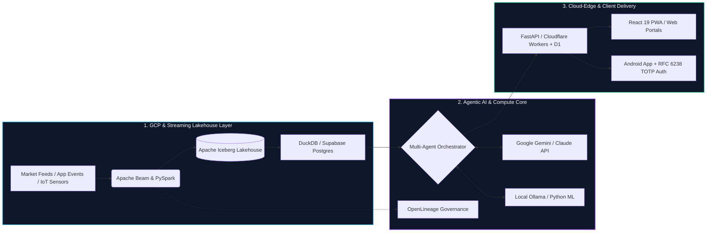

<div align="center">

<!-- IMAGE 1: CUSTOM ANIMATED HERO BANNER SVG -->


<br/>

<!-- DYNAMIC TYPING SUB-HOOK -->
<a href="https://vstechworks.co.in">
  
</a>

<br/>

<!-- PRIMARY LIVE & VERIFIED BADGES -->
[](https://www.credly.com/badges/3ac3c51b-8782-4017-9298-88191d76bfaa)
[](https://vstechworks.co.in)
[](https://www.seemas-abacus-academy.in.net/)
[](https://swarnasetu.pages.dev/)

<!-- SOCIAL & PROFILE LINKS -->
[](https://www.linkedin.com/in/satyajeet-dharmadhikari/)
[](https://www.credly.com/badges/3ac3c51b-8782-4017-9298-88191d76bfaa)
[](https://vstechworks.co.in)
[](https://x.com/satyad24)
[](https://www.kaggle.com/)

</div>

---

## ⚡ Why Clients Work With Me & [VS TechWorks](https://vstechworks.co.in)

Most freelance developers only touch one slice of the stack—either wrapping an LLM prompt without data engineering rigor, or building backend pipelines that never become usable products. 

As a **Google Cloud Certified Professional Data Engineer** co-building **[VS TechWorks](https://vstechworks.co.in)** alongside **[@vikrantkulle](https://github.com/vikrantkulle)**, I bridge **three critical engineering layers** under one roof:
1. **Production Data & Lakehouse Foundations:** Ingesting, cleaning, and governing high-velocity data using **PySpark, Apache Beam, Apache Iceberg, DuckDB, OpenLineage, and GCP**.
2. **Applied AI & Multi-Agent Orchestration:** Wiring domain data into **Google Gemini, Claude, OpenAI, and local Ollama models** with deterministic guardrails and structured outputs.
3. **Commercial Cloud-Edge SaaS Delivery:** Shipping responsive **React 19 PWAs, Android integrations, Supabase backends, and Cloudflare Workers/D1** systems with enterprise cryptography.

<!-- IMAGE 2: 4-COLUMN SERVICE PILLARS SVG -->
<div align="center">
  
</div>

---

## 💼 Freelance & Agency Service Matrix

| Engagement Track | Ideal For | Core Architecture & Stack | Key Deliverable |
| :--- | :--- | :--- | :--- |
| **🤖 Custom AI MVPs & Agentic Workflows** | Founders & teams automating complex analysis, document intelligence, or multi-step ops | `Gemini API` · `Claude` · `Ollama` · `FastAPI` · `React 19` · `Supabase` | Deployed full-stack AI web app or autonomous agent pipeline |
| **📊 Real-Time Data Lakehouses & Quant ETL** | FinTechs, trading desks & enterprises scaling streaming or batch analytics on cloud | `PySpark` · `Apache Beam` · `Iceberg` · `DuckDB` · `Airflow` · `GCP` | Governed lakehouse with automated lineage & sub-second SQL queries |
| **⚡ Full-Stack SaaS, FinTech & EdTech** | Businesses needing multi-role portals, offline sync, or device-bound licensing | `React 19` · `Vite` · `Cloudflare Pages/D1` · `Supabase` · `RFC 6238 TOTP` | Zero-latency cloud-edge SaaS / PWA with RBAC & admin telemetry |
| **📡 Edge IoT & Embedded ML Systems** | Hardware startups & smart-device teams building wearable or sensor intelligence | `ESP32` · `C++` · `MPU6050 IMU` · `I2C Multiplexing` · `Edge ML` | Custom microcontroller firmware + real-time sensor fusion pipeline |

---

## 🏗️ Featured Production Ecosystems

### 🏢 1. Commercial SaaS, FinTech & EdTech Shipments
> *Live, revenue-generating platforms engineered from database schema and cryptography to cloud-edge deployment.*

```text
📦 VS TechWorks & Commercial Products → Multi-Platform Cloud-Edge & Mobile SaaS
├── 🌐 VS TechWorks Studio            → AI engineering, full-stack SaaS & cloud architecture studio (vstechworks.co.in)
├── 🪙 SwarnaSetu (FinTech ERP)       → Gold-backed loan tracking + Offline 180-Day RFC 6238 TOTP Licensing (Android + Cloudflare)
├── 🧮 Seema's Abacus Platform        → Multi-user EdTech PWA, Student Portal & AI Practice Engine (React 19, Vite, Supabase, Gemini API)
└── 🔗 OmniLink Edge Shortener        → Serverless URL infrastructure with passcode gates & edge telemetry (Cloudflare Pages + D1 SQL)
```

<details>
<summary><b>🔍 Deep Dive: SwarnaSetu — FinTech ERP & Offline Cryptographic Licensing Engine (Click to Expand)</b></summary>
<br/>

- **Live Deployment:** [swarnasetu.pages.dev](https://swarnasetu.pages.dev/)
- **The Engineering Challenge:** Jewelers managing gold-backed collateral loans needed an offline-capable mobile & web system with tamper-proof subscription enforcement that operates reliably without constant internet connectivity.
- **What I Architected:**
  - **180-Day Device-Bound TOTP Engine:** Engineered a custom **RFC 6238 Time-Based One-Time Password (TOTP)** licensing handshake between the Cloudflare web portal and the Android application.
  - **Zero-Trust Offline Verification:** Binds cryptographic license keys to hardware device IDs with deterministic epoch windows, eliminating server-spoofing while allowing offline field operation.
  - **Full Subscriber & Loan Telemetry:** Real-time ledger management, interest calculation, and automated renewal workflows.

<!-- OPTIONAL SCREENSHOT: Upload assets/swarnasetu-preview.png and uncomment the line below -->
<!--  -->
</details>

<details>
<summary><b>🔍 Deep Dive: Seema's Abacus Academy — AI-Powered EdTech PWA & Management Ecosystem (Click to Expand)</b></summary>
<br/>

- **Live Deployment:** [seemas-abacus-academy.in.net](https://www.seemas-abacus-academy.in.net/)
- **Impact:** Serving **1,100+ students trained** with a **5.0★ rating** across levels 1–8 and competitive mental math cohorts.
- **What I Architected:**
  - **Multi-Role Progressive Web App (PWA):** Built with **React 19, Vite, Tailwind CSS, and Supabase** featuring dedicated Student, Teacher, and Admin portals.
  - **Generative AI & Algorithmic Practice Engine:** Integrated **Google Gemini API** and custom algorithmic Soroban worksheet generators for adaptive mental arithmetic drills and instant performance analytics.
  - **Offline-First & Installable:** Configured service workers and edge caching so students can practice seamlessly on low-bandwidth mobile devices.

<!-- OPTIONAL SCREENSHOT: Upload assets/seemas-abacus-preview.png and uncomment the line below -->
<!--  -->
</details>

---

### 📈 2. Financial Data Lakehouse & Quant AI Ecosystem
> *Real-time market streaming, multi-asset order-flow forecasting, and governed distributed data pipelines.*

```text
📊 Data & Quant Infrastructure → Streaming, Lineage & Market Intelligence
├── 🏦 Financial Market Lakehouse     → Real-time market streaming platform (Python, Apache Beam, PySpark, PyIceberg, DuckDB)
├── 📉 Multi-Market AI Forecasting    → Candlestick & order-flow analytics across Equities, Forex & Crypto + strategy simulation
├── 🧪 Automated Strategy Simulation  → Local multi-agent market simulation & execution pipelines (MiroFish + FYERS Automate)
└── 🔍 OpenLineage With PySpark       → Automated data lineage, governance, and pipeline observability at scale
```

<details>
<summary><b>🔍 Deep Dive: Financial Market Lakehouse & Multi-Market AI Forecasting (Click to Expand)</b></summary>
<br/>

- **Repositories:** [Financial-Market-Lakehouse](https://github.com/DharmadhikariSS/Financial-Market-Lakehouse) & [OpenLineage-With-PySpark](https://github.com/DharmadhikariSS/OpenLineage-With-PySpark)
- **What I Architected:**
  - **Streaming Ingestion to Iceberg Tables:** Built unified batch and streaming pipelines using **Apache Beam** and **PySpark** writing ACID-compliant parquet partitions into **Apache Iceberg**.
  - **Zero-Copy Analytical Queries:** Embedded **DuckDB** for sub-second OLAP queries over lakehouse snapshots without spinning up heavy warehouse clusters.
  - **Multi-Market Order Flow & Forecasting:** Designed multi-timeframe candlestick and order-flow feature pipelines feeding AI forecasting models across Equities, Forex, and Crypto, paired with automated strategy backtesting.
  - **End-to-End Lineage:** Integrated **OpenLineage** hooks into PySpark jobs to track dataset mutations, schema drift, and column-level dependencies automatically.
</details>

---

### 🧠 3. Agentic AI & Autonomous Engineering Workflows
> *Spec-driven multi-agent orchestration bridging IDE, terminal, local LLMs, and automated verification.*

```text
🤖 Agentic Engineering → Multi-Model Orchestration & Custom Developer Tooling
├── 🎛️ Antigravity & Claude Code      → Spec-driven multi-agent orchestration, UI verification & automated security audits
├── ⚡ Cursor & OpenCode Pipelines    → Context-aware codebase refactoring, terminal agents & zero-drift execution guardrails
├── 🧠 Local & Cloud LLM Engines      → Google Gemini API, Ollama local inference, structured outputs & automated synthesis
└── 📡 Edge IoT & Wearable ML         → ESP32 + MPU6050 IMU sensor fusion & real-time posture/motion ML classification
```

---

## 🗺️ Reference Architecture: How I Build End-to-End Systems



---

## 🛠️ Technology Arsenal

<div align="center">

#### 🤖 AI, LLMs & Cloud Data Engineering
[](https://vstechworks.co.in)

#### ⚡ Full-Stack, Cloud-Edge & Systems
[](https://vstechworks.co.in)

</div>

| Domain | Production Technologies & Tools |
| :--- | :--- |
| **AI & Agentic Systems** | Google Gemini API, Anthropic Claude, OpenAI SDK, Ollama (Local LLMs), Multi-Agent Workflows (`Antigravity`, `Claude Code`, `Cursor`, `OpenCode`), Structured Outputs, RAG, Machine Learning with Python |
| **Data & Cloud Lakehouse** | Google Cloud Platform (GCP), Python, PySpark, Apache Beam, Apache Iceberg, DuckDB, Apache Airflow, OpenLineage, Teradata, Ab Initio, Complex SQL |
| **Frontend & Mobile** | React 19, Vite, TypeScript, JavaScript (ES6+), Tailwind CSS, Progressive Web Apps (PWA), Android Integration |
| **Cloud, Edge & Backend** | FastAPI, Node.js, Django, Flask, Supabase (Postgres + Auth + Edge Functions), Cloudflare (Workers, Pages, D1 SQL), Docker, Kubernetes |
| **Security & Hardware** | RFC 6238 TOTP Cryptography, Cyber Law & InfoSec Auditing, C++, ESP32 Microcontrollers, MPU6050 IMU Sensor Fusion, Bash / Linux |

---

## 🎓 Credentials, Certifications & Background

<!-- IMAGE 3: CLICKABLE CREDENTIALS & CREDLY VERIFIED SVG BANNER -->
<div align="center">
  <a href="https://www.credly.com/badges/3ac3c51b-8782-4017-9298-88191d76bfaa">
    
  </a>
</div>

<br/>

<div align="center">

[](https://www.credly.com/badges/3ac3c51b-8782-4017-9298-88191d76bfaa)
[](https://www.credly.com/badges/3ac3c51b-8782-4017-9298-88191d76bfaa)
[](https://www.credly.com/badges/3ac3c51b-8782-4017-9298-88191d76bfaa)

</div>

### 📜 Verified Industry Certifications
- ☁️ **[Google Cloud Certified – Professional Data Engineer](https://www.credly.com/badges/3ac3c51b-8782-4017-9298-88191d76bfaa)** — *Google Cloud (Credly Verified)* · [🔗 View Official Credential](https://www.credly.com/badges/3ac3c51b-8782-4017-9298-88191d76bfaa)
- 🤖 **Machine Learning with Python** — *IBM*
- 📊 **Data Visualization with Python** — *IBM*

### 🏛️ Education & Leadership
- 🎓 **Master of Technology (M.Tech) in Cloud Computing** — *BITS Pilani*
- 🎓 **Bachelor of Technology (B.Tech)** + **Post Graduate Certificate in Cyber Law (PGCCL)**
- 🚀 **Co-Builder at [VS TechWorks](https://vstechworks.co.in)** alongside **[@vikrantkulle](https://github.com/vikrantkulle)** — delivering production AI systems, FinTech licensing engines, EdTech PWAs, and scalable data architectures.

---

## 📊 GitHub Telemetry & Engineering Activity

<div align="center">
  
  
</div>

---

## 📬 Let's Build Something Production-Grade

Whether you need a **custom AI agent workflow**, a **real-time financial/analytical data lakehouse on GCP**, or a **full-stack SaaS product shipped to the edge**, let's talk:

<div align="center">

[](https://vstechworks.co.in)
[](https://www.credly.com/badges/3ac3c51b-8782-4017-9298-88191d76bfaa)
[](https://www.linkedin.com/in/satyajeet-dharmadhikari/)
[](https://x.com/satyad24)

*"From raw streaming data to autonomous AI agents and zero-latency cloud-edge products."*

</div>
