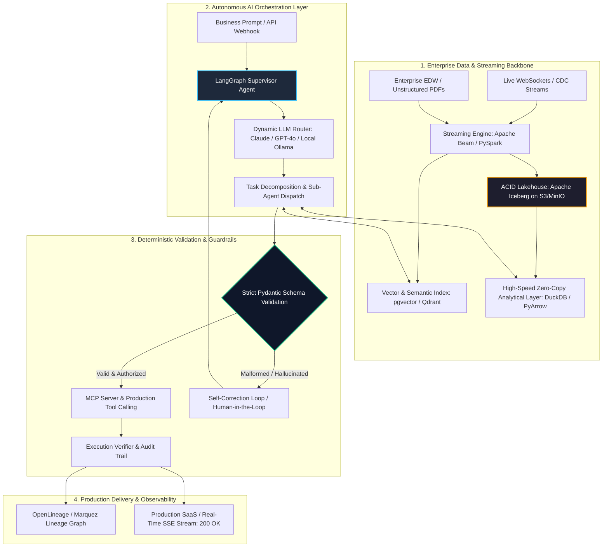

<div align="center">

<!-- DYNAMIC TYPING HERO -->
<a href="https://github.com/DharmadhikariSS">
  
</a>

<br/><br/>

<!-- QUICK ACTION & STATUS BADGES -->
[](mailto:satyajeetdharmadhikari24@gmail.com)
[](https://linkedin.com/in/satyajeet-dharmadhikari)
[](mailto:satyajeetdharmadhikari24@gmail.com)
[](https://linkedin.com/in/satyajeet-dharmadhikari)
[](https://linkedin.com/in/satyajeet-dharmadhikari)

<br/>

<!-- INTERACTIVE NAVIGATION BAR -->
<table>
  <tr>
    <td align="center"><b><a href="#-about-me--value-proposition">⚡ About</a></b></td>
    <td align="center"><b><a href="#-ai-system-architecture--engineering-philosophy">🧠 System Architecture</a></b></td>
    <td align="center"><b><a href="#-selected-flagship-projects">🚀 Flagship Projects</a></b></td>
    <td align="center"><b><a href="#%EF%B8%8F-technical-skills--arsenal">🛠️ Tech Arsenal</a></b></td>
    <td align="center"><b><a href="#-enterprise-track-record--production-rigor">🏢 Enterprise Scale</a></b></td>
    <td align="center"><b><a href="#-applied-research--academic-credentials">🎓 Research &amp; Degrees</a></b></td>
    <td align="center"><b><a href="#-lets-collaborate--hire">📬 Work With Me</a></b></td>
  </tr>
</table>

</div>

---

### ⚡ About Me & Value Proposition

> **"Most AI agents fail in production not because of weak prompts, but because of fragile data foundations, unvalidated state execution, and zero resilience."**

I am an **AI Systems & Autonomous Agents Engineer** with nearly **4 years of enterprise engineering experience** architecting high-throughput data backends, streaming lakehouses, and mission-critical cloud pipelines at **Vodafone Intelligent Solutions (VOIS)**.

I bridge the critical gap between **deep distributed data infrastructure** (500 GB+ daily volumes, 15+ TB migrations, Apache Iceberg, PySpark) and **production-grade Agentic AI** (LangGraph, Model Context Protocol, GraphRAG, zero-hallucination structured outputs). 

Currently pursuing an **M.Tech in Cloud Computing at BITS Pilani**, focused on data lineage, cloud-native orchestration, and reliable agentic governance.

```
┌────────────────────────────────────────────────────────────────────────────────────────┐
│  THE DUAL SUPERPOWER:                                                                 │
│  [ Enterprise Data Backbone (500GB+/day) ]  +  [ Autonomous Multi-Agent AI (MCP) ]     │
│  → Production-grade agents backed by deterministic data contracts & 99.5% SLA rigor    │
└────────────────────────────────────────────────────────────────────────────────────────┘
```

#### 🎯 What I Bring to Teams & Clients:
* **Autonomous Multi-Agent Systems:** Stateful supervisor-worker architectures (LangGraph, CrewAI), tool-calling networks via **Model Context Protocol (MCP)**, persistent memory, and human-in-the-loop safety gates.
* **Production Agentic RAG & Text-to-SQL:** Hybrid dense/sparse retrieval (pgvector, Qdrant, DuckDB), query decomposition, self-correcting SQL execution agents, and strict citation grounding.
* **High-Throughput Streaming Lakehouses:** Real-time event ingestion (PySpark, Apache Beam, Redpanda/Kafka), ACID transactions with **Apache Iceberg**, and high-speed zero-copy analytics via **PyArrow Flight**.
* **Full-Stack AI Application Engineering:** Modular, low-latency microservices with **FastAPI**, real-time token streaming with **Next.js / React**, and containerized deployments via **Docker**.
* **Zero-Hallucination Guarantees:** Enforcing strict Pydantic JSON validation schemas, deterministic fallback paths, and observability tracking (OpenLineage, Marquez, LangSmith).

---

### 🧠 AI System Architecture & Engineering Philosophy

#### Reliable Agentic Reasoning Bound to Deterministic Data Contracts
In production enterprise environments, probabilistic reasoning must never directly mutate databases or make irreversible transactions without strict validation gates and audit trails.



---

### 🚀 Selected Flagship Projects

Below is a curated showcase spanning **Autonomous AI Agents**, **Enterprise Lakehouses**, and **Production Web Applications**:

<table>
  <!-- PROJECT 1: NEXUS AI -->
  <tr>
    <td width="60%" valign="top">
      <h3>🤖 1. NexusAI — Autonomous Business Workflow &amp; Multi-Agent Platform</h3>
      <b>Agentic AI • Multi-Agent Orchestration • MCP Tool Servers</b><br/>
      <code>Production Ready Architecture</code>
      <br/><br/>
      An enterprise-grade autonomous AI automation platform orchestrating specialized agent swarms across business workflows, CRM integrations, document processing, and dynamic database querying.
      <ul>
        <li>Implemented dynamic multi-model routing across <b>Anthropic Claude, GPT-4o, Google Gemini, and Local Ollama</b>.</li>
        <li>Built custom <b>Model Context Protocol (MCP)</b> servers with strict JSON schema validation, state checkpointing, and human-in-the-loop webhooks.</li>
        <li>Eliminates hallucinated actions via deterministic schema contracts and error recovery loops.</li>
      </ul>
      <b>Stack:</b> <code>Python</code> • <code>LangGraph</code> • <code>FastAPI</code> • <code>MCP</code> • <code>Next.js</code> • <code>Docker</code>
    </td>
    <td width="40%" align="center" valign="middle">
      
      <br/><br/>
      
      <br/><br/>
      <sub>Stateful multi-agent supervisor with custom MCP tools</sub>
    </td>
  </tr>

  <!-- PROJECT 2: OMNISEARCH -->
  <tr>
    <td width="60%" valign="top">
      <h3>🔍 2. OmniSearch — Enterprise Agentic RAG &amp; Text-to-SQL Copilot</h3>
      <b>Generative AI • Hybrid Retrieval • Self-Correcting SQL Agents</b><br/>
      <code>Enterprise Analytics Copilot</code>
      <br/><br/>
      A dual-engine business intelligence copilot combining semantic vector retrieval over unstructured enterprise documents with self-correcting Text-to-SQL agents over structured operational data.
      <ul>
        <li>Automated ingestion pipeline with semantic chunking, metadata filtering, and query decomposition.</li>
        <li>Features self-correcting SQL execution: LLM iteratively inspects query syntax errors, schema drift, and re-executes safely.</li>
        <li>Zero-hallucination citation grounding with source attribution and RBAC security controls.</li>
      </ul>
      <b>Stack:</b> <code>Python</code> • <code>LLMs</code> • <code>pgvector / Qdrant</code> • <code>DuckDB</code> • <code>FastAPI</code> • <code>Docker</code>
    </td>
    <td width="40%" align="center" valign="middle">
      
      <br/><br/>
      
      <br/><br/>
      <sub>Hybrid vector + structured analytical copilot</sub>
    </td>
  </tr>

  <!-- PROJECT 3: REAL-TIME FINANCIAL LAKEHOUSE -->
  <tr>
    <td width="60%" valign="top">
      <h3>🌊 3. Financial Market Lakehouse &amp; Streaming Platform</h3>
      <b>Real-Time Data Engineering • Apache Iceberg • Distributed Compute</b><br/>
      <a href="https://github.com/DharmadhikariSS/Financial-Market-Lakehouse-Streaming-Platform"><code>github.com/DharmadhikariSS/Financial-Market-Lakehouse-Streaming-Platform</code></a>
      <br/><br/>
      An end-to-end financial market lakehouse ingesting live WebSocket streams and Change Data Capture (CDC) events into <b>Apache Iceberg ACID tables</b> on MinIO S3 object storage to power real-time AI/ML feature serving.
      <ul>
        <li>Engineered streaming pipelines using <b>Apache Beam &amp; PySpark</b> for rolling multi-asset VWAP calculations.</li>
        <li>Enforced schema contracts, data validation, and Dead-Letter Queue (DLQ) fault isolation.</li>
        <li>Modeled dimensional star schemas (<code>fct_trades</code>, <code>dim_assets</code>) with <b>dbt-duckdb</b>, serving zero-copy analytical queries via <b>PyArrow Flight</b>.</li>
      </ul>
      <b>Stack:</b> <code>PySpark</code> • <code>Apache Beam</code> • <code>PyIceberg</code> • <code>DuckDB</code> • <code>dbt</code> • <code>MinIO</code>
    </td>
    <td width="40%" align="center" valign="middle">
      <a href="https://github.com/DharmadhikariSS/Financial-Market-Lakehouse-Streaming-Platform">
        
      </a>
      <br/><br/>
      <a href="https://github.com/DharmadhikariSS/Financial-Market-Lakehouse-Streaming-Platform">
        
      </a>
      <br/><br/>
      <sub>Streaming Iceberg Lakehouse with PyArrow Flight</sub>
    </td>
  </tr>

  <!-- PROJECT 4: OPENLINEAGE & DATA GOVERNANCE -->
  <tr>
    <td width="60%" valign="top">
      <h3>🛡️ 4. Cloud-Native Data Provenance &amp; Lineage Observability</h3>
      <b>Data Observability • OpenLineage • Pipeline Governance</b><br/>
      <a href="https://github.com/DharmadhikariSS/OpenLineage-With-PySpark"><code>github.com/DharmadhikariSS/OpenLineage-With-PySpark</code></a>
      <br/><br/>
      An automated ETL lineage tracking and pipeline governance solution on Google Cloud Platform (GCP) integrating PySpark, Dockerized Apache Airflow, OpenLineage API, and Marquez metadata repositories.
      <ul>
        <li>Captures column-level lineage and dataset dependencies automatically during distributed Spark runs.</li>
        <li>Orchestrated modular data pipelines in Dockerized Airflow, delivering visual metadata dashboards.</li>
        <li>Reduced operational pipeline debugging and incident root-cause analysis time by <b>60%</b>.</li>
      </ul>
      <b>Stack:</b> <code>GCP</code> • <code>PySpark</code> • <code>Apache Airflow</code> • <code>OpenLineage</code> • <code>Marquez</code> • <code>Docker</code>
    </td>
    <td width="40%" align="center" valign="middle">
      <a href="https://github.com/DharmadhikariSS/OpenLineage-With-PySpark">
        
      </a>
      <br/><br/>
      <a href="https://github.com/DharmadhikariSS/OpenLineage-With-PySpark">
        
      </a>
      <br/><br/>
      <sub>Automated PySpark column-level provenance tracking</sub>
    </td>
  </tr>

  <!-- PROJECT 5: SEEMA'S ABACUS ACADEMY -->
  <tr>
    <td width="60%" valign="top">
      <h3>🎓 5. Seema's Abacus Academy — Digital Platform &amp; Management System</h3>
      <b>Production Web Platform • Academy Management • Student Inquiries</b><br/>
      <a href="https://seemas-abacus-academy.in.net/"><code>https://seemas-abacus-academy.in.net/</code></a>
      <br/><br/>
      A high-performance digital platform and student inquiry management system engineered for an established 22+ year academy institution.
      <ul>
        <li>Structured curriculum discovery, batch tracking, student assessment workflows, and responsive inquiry capture.</li>
        <li>Engineered for high-conversion student admissions with sub-second page loads and cross-device optimization.</li>
        <li>Zero-downtime deployment, secure data handling, and automated notification integrations.</li>
      </ul>
      <b>Stack:</b> <code>JavaScript</code> • <code>Responsive UI/UX</code> • <code>REST APIs</code> • <code>Cloud Hosting</code>
    </td>
    <td width="40%" align="center" valign="middle">
      <a href="https://seemas-abacus-academy.in.net/">
        
      </a>
      <br/><br/>
      <a href="https://seemas-abacus-academy.in.net/">
        
      </a>
      <br/><br/>
      <sub>Commercial production academy platform</sub>
    </td>
  </tr>

  <!-- PROJECT 6: OMNILINK CLOUDFLARE -->
  <tr>
    <td width="60%" valign="top">
      <h3>⚡ 6. OmniLink — Universal Cloudflare Edge URL Engine &amp; Analytics</h3>
      <b>Edge Computing • Cloudflare Workers • D1 SQL Serverless</b><br/>
      <a href="https://github.com/DharmadhikariSS/OmniLink-Universal-Cloudflare-URL-Shortener"><code>github.com/DharmadhikariSS/OmniLink-Universal-Cloudflare-URL-Shortener</code></a>
      <br/><br/>
      High-performance universal URL shortener and QR generation studio running 100% on Cloudflare global edge network with zero third-party limitations.
      <ul>
        <li>Built with Cloudflare Workers and D1 Serverless SQL for sub-10ms global edge redirects.</li>
        <li>Features client-side QR studio, passcode-protected links, and real-time click telemetry analytics.</li>
      </ul>
      <b>Stack:</b> <code>Cloudflare Workers</code> • <code>D1 SQL</code> • <code>JavaScript</code> • <code>Edge Analytics</code>
    </td>
    <td width="40%" align="center" valign="middle">
      <a href="https://github.com/DharmadhikariSS/OmniLink-Universal-Cloudflare-URL-Shortener">
        
      </a>
      <br/><br/>
      <a href="https://github.com/DharmadhikariSS/OmniLink-Universal-Cloudflare-URL-Shortener">
        
      </a>
      <br/><br/>
      <sub>Serverless D1 SQL edge redirection &amp; analytics</sub>
    </td>
  </tr>
</table>

---

### 🛠️ Technical Skills & Arsenal

<table>
  <tr>
    <td width="28%"><strong>🤖 Generative &amp; Agentic AI</strong></td>
    <td>
      <code>LangGraph</code> • <code>Model Context Protocol (MCP)</code> • <code>LangChain</code> • <code>CrewAI</code> • <code>Autonomous Agent Swarms</code> • <code>Agentic RAG</code> • <code>GraphRAG</code> • <code>Tool / Function Calling</code> • <code>Structured JSON Outputs</code> • <code>Context Engineering</code>
    </td>
  </tr>
  <tr>
    <td width="28%"><strong>🧠 LLM Platforms &amp; Inference</strong></td>
    <td>
      <code>Anthropic Claude (3.5 Sonnet / 3.7)</code> • <code>OpenAI (GPT-4o / o1)</code> • <code>Google Gemini &amp; Vertex AI</code> • <code>Groq (LPU Inference)</code> • <code>Local LLMs (Ollama, vLLM, Llama 3, Gemma)</code> • <code>Multi-Modal AI</code>
    </td>
  </tr>
  <tr>
    <td width="28%"><strong>🌊 Data Engineering &amp; Lakehouse</strong></td>
    <td>
      <code>Apache Iceberg</code> • <code>PySpark</code> • <code>Apache Beam</code> • <code>DuckDB</code> • <code>dbt</code> • <code>PyArrow Flight</code> • <code>Ab Initio (GDE, Co-Operating System)</code> • <code>Teradata (Vantage, BTEQ, FastLoad)</code> • <code>Google BigQuery</code> • <code>Dimensional Star Modeling</code> • <code>CDC</code>
    </td>
  </tr>
  <tr>
    <td width="28%"><strong>🔍 Vector &amp; Storage Backends</strong></td>
    <td>
      <code>pgvector</code> • <code>Qdrant</code> • <code>Pinecone</code> • <code>ChromaDB</code> • <code>PostgreSQL</code> • <code>Redis</code> • <code>MinIO S3</code> • <code>Google Cloud Storage (GCS)</code>
    </td>
  </tr>
  <tr>
    <td width="28%"><strong>⚙️ Backend &amp; Distributed Systems</strong></td>
    <td>
      <code>Python</code> • <code>FastAPI</code> • <code>RESTful APIs</code> • <code>WebSockets</code> • <code>Microservices</code> • <code>Kafka / Redpanda</code> • <code>Pydantic (Schema Validation)</code> • <code>SQL</code> • <code>UNIX Shell Scripting</code>
    </td>
  </tr>
  <tr>
    <td width="28%"><strong>🌐 Frontend &amp; AI Interfaces</strong></td>
    <td>
      <code>Next.js</code> • <code>React</code> • <code>TypeScript</code> • <code>JavaScript</code> • <code>Tailwind CSS</code> • <code>Streamlit</code> • <code>Real-Time Token Streaming UI</code> • <code>AI Copilot Chat Panels</code>
    </td>
  </tr>
  <tr>
    <td width="28%"><strong>☁️ Cloud, MLOps &amp; Governance</strong></td>
    <td>
      <code>Google Cloud Platform (GCP)</code> • <code>Dataproc</code> • <code>Cloud Composer (Airflow)</code> • <code>Docker</code> • <code>CI/CD (GitHub Actions)</code> • <code>OpenLineage</code> • <code>Marquez</code> • <code>OpenMetadata</code> • <code>Control-M</code> • <code>Linux</code>
    </td>
  </tr>
</table>

---

### 🏢 Enterprise Track Record & Production Rigor

#### **Vodafone Intelligent Solutions (VOIS) — Enterprise Data & Platform Engineering**
**Senior Executive & Graduate Engineer Trainee (Nov 2022 – Present | Pune, India)**

* **500 GB+ Daily Scale:** Manage and optimize mission-critical Teradata EDW operations supporting daily business data loads exceeding 500 GB while strictly adhering to a **99.5% production SLA**.
* **15+ TB Cloud Modernization:** Spearheaded enterprise data modernization by migrating 15+ TB of legacy warehouse data to Teradata Vantage and refactoring 50+ automation scripts for higher throughput and modularity.
* **40% Manual Effort Reduction:** Designed and automated intelligent workflow monitoring and self-healing alerting across Linux environments, eliminating manual operational bottlenecks by 40%.
* **30+ Production Integration Graphs:** Built and optimized 30+ Ab Initio graphs integrating relational databases (Oracle, Teradata), flat files, and APIs. Improved pipeline throughput by **25%** via compute graph refactoring and partition strategies.
* **95%+ Defect-Free Deployments:** Enforced strict enterprise SDLC gates, end-to-end integration validation, and automated unit testing in HP ALM.

---

### 🎓 Applied Research & Academic Credentials

* 🎓 **BITS Pilani — Work Integrated Learning Programmes (WILP)**
  * **M.Tech in Cloud Computing** *(2024 – 2026)*
  * Research Focus: *Automated Data Provenance, Cloud-Native ETL Lineage, and Decentralized Agent Governance.*
* 🎓 **M. S. Bidve Engineering College, Latur**
  * **B.Tech in Computer Science & Engineering** *(2018 – 2022 | CGPA: 8.09 / 10)*
* 📜 **Professional Certifications & Honors:**
  * **Google Cloud Certified — Professional Data Engineer** (Credly)
  * **Machine Learning with Python** — IBM
  * **Data Visualization with Python** — IBM
  * 🏆 **Datathon Winner** — Standard Chartered Bank
  * 🎖️ **Master of Web Award**
  * 🤝 **District Secretary** — Rotaract District 3132

---

### 📊 GitHub Activity & Metrics

<div align="center">

<table border="0">
  <tr>
    <td>
      <a href="https://github.com/DharmadhikariSS">
        
      </a>
    </td>
    <td>
      <a href="https://github.com/DharmadhikariSS">
        
      </a>
    </td>
  </tr>
</table>

</div>

---

### 📬 Let's Collaborate & Hire

Whether you are looking for an **AI Engineer** who knows how to scale data infrastructure or need a high-impact **freelance AI solution**, let's build something exceptional together.

#### 💼 Opportunities I Am Open To:
1. **Full-Time Roles:** AI Engineer, Applied AI Engineer, Senior Data Platform & AI Systems Architect *(Open to Remote across India, US, EU, UAE, or Hybrid in Pune/Bangalore)*.
2. **Freelance & Scoped Consulting:** 
   * Custom Multi-Agent Systems & MCP Server Integrations (LangGraph).
   * Enterprise Agentic RAG & Self-Correcting Text-to-SQL Engines.
   * High-throughput Streaming Lakehouses (PySpark, Iceberg, DuckDB).
   * Production AI SaaS MVPs (FastAPI + Next.js + Vector DB).

<div align="center">

[](https://linkedin.com/in/satyajeet-dharmadhikari)
[](mailto:satyajeetdharmadhikari24@gmail.com)
[](https://github.com/DharmadhikariSS)

<br/>

**Direct Contact:** `satyajeetdharmadhikari24@gmail.com` • `+91 9404311580` • **Pune, Maharashtra, India**

<br/>

```
┌────────────────────────────────────────────────────────────────────────┐
│  Engineered with enterprise rigor, real-time data & agentic precision  │
│  © 2026 Satyajeet Dharmadhikari • Built to scale                       │
└────────────────────────────────────────────────────────────────────────┘
```

</div>
