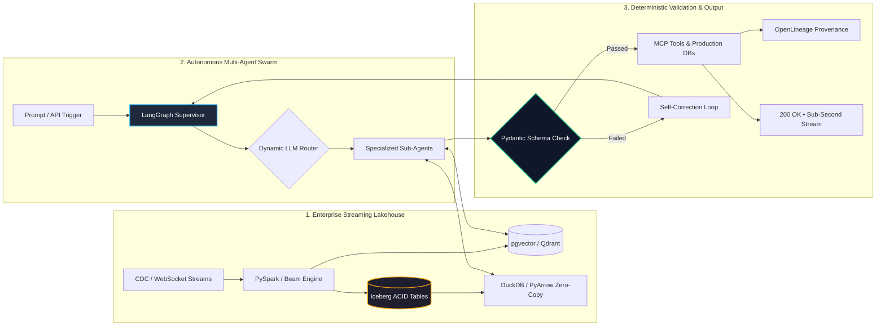

<div align="center">

<!-- HERO BROWSER FRAME -->
<a href="https://github.com/DharmadhikariSS">
  
</a>

<br/>

<!-- CALIBRATED DYNAMIC TYPING HEADLINE (ZERO CLIPPING) -->
<a href="https://github.com/DharmadhikariSS">
  
</a>

<br/><br/>

<!-- ACTION BADGES -->
[](mailto:satyajeetdharmadhikari24@gmail.com)
[](https://linkedin.com/in/satyajeet-dharmadhikari)
[](mailto:satyajeetdharmadhikari24@gmail.com)
[](https://linkedin.com/in/satyajeet-dharmadhikari)
[](https://linkedin.com/in/satyajeet-dharmadhikari)

<br/>

<!-- QUICK NAV -->
<table>
  <tr>
    <td align="center"><b><a href="#-the-dual-superpower">⚡ Superpower</a></b></td>
    <td align="center"><b><a href="#-live-orchestrator-terminal">🤖 Live Terminal</a></b></td>
    <td align="center"><b><a href="#-system-architecture">🧠 Architecture</a></b></td>
    <td align="center"><b><a href="#-featured-projects">🚀 Projects</a></b></td>
    <td align="center"><b><a href="#%EF%B8%8F-technical-arsenal">🛠️ Tech Arsenal</a></b></td>
    <td align="center"><b><a href="#-enterprise-scale--research">🏢 Scale &amp; Research</a></b></td>
    <td align="center"><b><a href="#-work-with-me">📬 Contact</a></b></td>
  </tr>
</table>

</div>

---

### ⚡ The Dual Superpower

> **"Most AI agents fail in production not because of prompts, but because of fragile data pipelines and unvalidated state execution. I engineer autonomous AI systems backed by enterprise data reliability."**

With nearly **4 years of enterprise engineering experience** at **Vodafone Intelligent Solutions (VOIS)** managing **500 GB+ daily transactions** and **15+ TB migrations**, I unite two worlds:

<table>
  <tr>
    <td width="33%" valign="top">
      <h4>🤖 Autonomous Agentic AI</h4>
      <ul>
        <li><b>LangGraph Swarms:</b> Stateful supervisor-worker agent graphs with checkpointed memory.</li>
        <li><b>Model Context Protocol:</b> Dynamic MCP tool servers with strict Pydantic schemas.</li>
        <li><b>Zero-Hallucination:</b> Self-correcting Text-to-SQL, verified RAG citations &amp; guardrails.</li>
      </ul>
    </td>
    <td width="33%" valign="top">
      <h4>🌊 Real-Time Lakehouses</h4>
      <ul>
        <li><b>Apache Iceberg:</b> ACID lakehouse tables ingesting WebSocket CDC streams on MinIO/S3.</li>
        <li><b>Distributed Compute:</b> High-throughput streaming via PySpark, Apache Beam &amp; Kafka.</li>
        <li><b>Zero-Copy Serving:</b> Sub-second analytics powered by DuckDB &amp; PyArrow Flight.</li>
      </ul>
    </td>
    <td width="33%" valign="top">
      <h4>🛡️ Enterprise Production Rigor</h4>
      <ul>
        <li><b>500 GB+/Day Scale:</b> 99.5% SLA adherence across mission-critical EDW pipelines.</li>
        <li><b>Pipeline Observability:</b> Automated column lineage with OpenLineage, Marquez &amp; GCP.</li>
        <li><b>Cloud Master's:</b> Pursuing M.Tech in Cloud Computing at <b>BITS Pilani</b>.</li>
      </ul>
    </td>
  </tr>
</table>

---

### 🤖 Live Orchestrator Terminal

When building AI for business operations, **probabilistic reasoning must be bound to deterministic execution and validated data contracts**:

<div align="center">
  
</div>

---

### 🧠 System Architecture



---

### 🚀 Featured Projects

<table>
  <!-- PROJECT 1: NEXUS AI -->
  <tr>
    <td width="60%" valign="top">
      <h3>🤖 NexusAI — Autonomous Multi-Agent Automation Platform</h3>
      <b>Agentic AI • Multi-Agent Orchestration • Model Context Protocol (MCP)</b><br/>
      <ul>
        <li>Engineered plug-and-play autonomous multi-agent platform with dynamic routing across <b>Claude 3.5, GPT-4o, Gemini &amp; local Ollama</b>.</li>
        <li>Integrated custom <b>MCP tool servers</b>, typed state checkpointing, and human-in-the-loop webhooks with zero-hallucination JSON schema guarantees.</li>
      </ul>
      <b>Stack:</b> <code>Python</code> • <code>LangGraph</code> • <code>FastAPI</code> • <code>MCP</code> • <code>Next.js</code> • <code>Docker</code>
    </td>
    <td width="40%" align="center" valign="middle">
      
      <br/><br/>
      
      <br/><br/>
      <sub>Dynamic multi-model routing &amp; MCP tool servers</sub>
    </td>
  </tr>

  <!-- PROJECT 2: OMNISEARCH -->
  <tr>
    <td width="60%" valign="top">
      <h3>🔍 OmniSearch — Enterprise Agentic RAG &amp; Text-to-SQL Copilot</h3>
      <b>Generative AI • Hybrid Retrieval • Self-Correcting SQL Agents</b><br/>
      <ul>
        <li>Hybrid BI copilot combining dense vector retrieval over unstructured documents with self-correcting Text-to-SQL agents over relational databases.</li>
        <li>Automated semantic ingestion pipeline with citation grounding, query decomposition, and RBAC security delivering sub-second answers.</li>
      </ul>
      <b>Stack:</b> <code>Python</code> • <code>pgvector / Qdrant</code> • <code>DuckDB</code> • <code>FastAPI</code> • <code>Docker</code>
    </td>
    <td width="40%" align="center" valign="middle">
      
      <br/><br/>
      
      <br/><br/>
      <sub>Hybrid semantic vector + structured SQL copilot</sub>
    </td>
  </tr>

  <!-- PROJECT 3: REAL-TIME FINANCIAL LAKEHOUSE -->
  <tr>
    <td width="60%" valign="top">
      <h3>🌊 Financial Market Lakehouse &amp; Streaming Platform</h3>
      <b>Real-Time Data Lakehouse • Apache Iceberg • Distributed Stream Compute</b><br/>
      <a href="https://github.com/DharmadhikariSS/Financial-Market-Lakehouse-Streaming-Platform"><code>github.com/DharmadhikariSS/Financial-Market-Lakehouse-Streaming-Platform</code></a>
      <ul>
        <li>Ingests live financial WebSocket streams and CDC events into <b>Apache Iceberg ACID tables</b> on MinIO S3 object storage for real-time feature serving.</li>
        <li>Engineered <b>Apache Beam &amp; PySpark</b> pipelines for rolling multi-asset VWAP, dbt star modeling, and zero-copy queries via <b>PyArrow Flight</b>.</li>
      </ul>
      <b>Stack:</b> <code>PySpark</code> • <code>Apache Beam</code> • <code>PyIceberg</code> • <code>DuckDB</code> • <code>dbt</code> • <code>MinIO</code>
    </td>
    <td width="40%" align="center" valign="middle">
      <a href="https://github.com/DharmadhikariSS/Financial-Market-Lakehouse-Streaming-Platform">
        
      </a>
      <br/><br/>
      <a href="https://github.com/DharmadhikariSS/Financial-Market-Lakehouse-Streaming-Platform">
        
      </a>
      <br/><br/>
      <sub>Streaming Iceberg Lakehouse with PyArrow Flight</sub>
    </td>
  </tr>

  <!-- PROJECT 4: OPENLINEAGE & DATA GOVERNANCE -->
  <tr>
    <td width="60%" valign="top">
      <h3>🛡️ Cloud-Native Data Provenance &amp; Lineage Observability</h3>
      <b>Data Observability • OpenLineage • Pipeline Governance</b><br/>
      <a href="https://github.com/DharmadhikariSS/OpenLineage-With-PySpark"><code>github.com/DharmadhikariSS/OpenLineage-With-PySpark</code></a>
      <ul>
        <li>Automated ETL lineage tracking integrating PySpark pipelines with <b>OpenLineage API</b> and Marquez metadata repository on Google Cloud Platform.</li>
        <li>Dockerized Airflow orchestration with interactive metadata dashboards that reduced pipeline troubleshooting time by <b>60%</b>.</li>
      </ul>
      <b>Stack:</b> <code>GCP</code> • <code>PySpark</code> • <code>Apache Airflow</code> • <code>OpenLineage</code> • <code>Marquez</code> • <code>Docker</code>
    </td>
    <td width="40%" align="center" valign="middle">
      <a href="https://github.com/DharmadhikariSS/OpenLineage-With-PySpark">
        
      </a>
      <br/><br/>
      <a href="https://github.com/DharmadhikariSS/OpenLineage-With-PySpark">
        
      </a>
      <br/><br/>
      <sub>Automated column-level provenance tracking</sub>
    </td>
  </tr>

  <!-- PROJECT 5: SEEMA'S ABACUS ACADEMY -->
  <tr>
    <td width="60%" valign="top">
      <h3>🎓 Seema's Abacus Academy — Platform &amp; Management System</h3>
      <b>Production Web Platform • Academy Management • Student Inquiries</b><br/>
      <a href="https://seemas-abacus-academy.in.net/"><code>https://seemas-abacus-academy.in.net/</code></a>
      <ul>
        <li>Commercial management platform engineered for an established 22+ year academy institution, streamlining admissions and student progress tracking.</li>
        <li>Features interactive curriculum discovery, automated inquiry capture, and sub-second cross-device mobile optimization.</li>
      </ul>
      <b>Stack:</b> <code>JavaScript</code> • <code>Responsive UI/UX</code> • <code>REST APIs</code> • <code>Cloud Hosting</code>
    </td>
    <td width="40%" align="center" valign="middle">
      <a href="https://seemas-abacus-academy.in.net/">
        
      </a>
      <br/><br/>
      <a href="https://seemas-abacus-academy.in.net/">
        
      </a>
      <br/><br/>
      <sub>Commercial production academy platform</sub>
    </td>
  </tr>

  <!-- PROJECT 6: OMNILINK CLOUDFLARE -->
  <tr>
    <td width="60%" valign="top">
      <h3>⚡ OmniLink — Universal Cloudflare Edge URL Engine &amp; Analytics</h3>
      <b>Edge Computing • Cloudflare Workers • D1 SQL Serverless</b><br/>
      <a href="https://github.com/DharmadhikariSS/OmniLink-Universal-Cloudflare-URL-Shortener"><code>github.com/DharmadhikariSS/OmniLink-Universal-Cloudflare-URL-Shortener</code></a>
      <ul>
        <li>Universal URL shortener running 100% on Cloudflare edge network with sub-10ms redirects, passcode protection, and QR code studio.</li>
        <li>Zero third-party limitations using serverless D1 SQL with real-time click telemetry analytics.</li>
      </ul>
      <b>Stack:</b> <code>Cloudflare Workers</code> • <code>D1 SQL</code> • <code>JavaScript</code> • <code>Edge Analytics</code>
    </td>
    <td width="40%" align="center" valign="middle">
      <a href="https://github.com/DharmadhikariSS/OmniLink-Universal-Cloudflare-URL-Shortener">
        
      </a>
      <br/><br/>
      <a href="https://github.com/DharmadhikariSS/OmniLink-Universal-Cloudflare-URL-Shortener">
        
      </a>
      <br/><br/>
      <sub>Sub-10ms serverless edge redirection &amp; analytics</sub>
    </td>
  </tr>
</table>

---

### 🛠️ Technical Arsenal

<table>
  <tr>
    <td width="28%"><strong>🤖 Agentic &amp; Generative AI</strong></td>
    <td><code>LangGraph</code> • <code>Model Context Protocol (MCP)</code> • <code>LangChain</code> • <code>CrewAI</code> • <code>Multi-Agent Swarms</code> • <code>GraphRAG</code> • <code>Agentic RAG</code> • <code>Structured Outputs</code> • <code>Prompt Engineering</code></td>
  </tr>
  <tr>
    <td width="28%"><strong>🧠 Frontier &amp; Local LLMs</strong></td>
    <td><code>Anthropic Claude (3.5 Sonnet / 3.7)</code> • <code>OpenAI (GPT-4o / o1)</code> • <code>Google Gemini &amp; Vertex AI</code> • <code>Groq (LPU)</code> • <code>Local Ollama / vLLM / Llama 3</code></td>
  </tr>
  <tr>
    <td width="28%"><strong>🌊 Lakehouse &amp; Streaming</strong></td>
    <td><code>Apache Iceberg</code> • <code>PySpark</code> • <code>Apache Beam</code> • <code>DuckDB</code> • <code>dbt</code> • <code>PyArrow Flight</code> • <code>Kafka / Redpanda</code> • <code>Teradata Vantage</code> • <code>Google BigQuery</code></td>
  </tr>
  <tr>
    <td width="28%"><strong>🔍 Vector &amp; Storage</strong></td>
    <td><code>pgvector</code> • <code>Qdrant</code> • <code>Pinecone</code> • <code>ChromaDB</code> • <code>PostgreSQL</code> • <code>Redis</code> • <code>MinIO S3</code> • <code>Google Cloud Storage</code></td>
  </tr>
  <tr>
    <td width="28%"><strong>⚙️ Backend &amp; Frontend</strong></td>
    <td><code>Python</code> • <code>FastAPI</code> • <code>Next.js</code> • <code>React</code> • <code>TypeScript</code> • <code>Tailwind CSS</code> • <code>WebSockets</code> • <code>REST APIs</code> • <code>Docker</code></td>
  </tr>
  <tr>
    <td width="28%"><strong>☁️ Cloud &amp; Governance</strong></td>
    <td><code>Google Cloud Platform (GCP)</code> • <code>Dataproc</code> • <code>Apache Airflow (Composer)</code> • <code>OpenLineage</code> • <code>Marquez</code> • <code>CI/CD (GitHub Actions)</code> • <code>Linux</code></td>
  </tr>
</table>

---

### 🏢 Enterprise Scale & Research

<div align="center">

| 📊 500 GB+ Daily Scale | ⏱️ 99.5% Production SLA | 🚀 15+ TB Cloud Modernization | ⚡ 40% Automation Savings |
| :---: | :---: | :---: | :---: |
| Enterprise Teradata EDW operations at VOIS | Rigorous SLA compliance across core pipelines | Legacy warehouse migrated to Teradata Vantage | Manual bottlenecks eliminated via smart alerting |

</div>

#### **Enterprise Track Record:**
* **Vodafone Intelligent Solutions (VOIS) — Senior Executive & Graduate Engineer Trainee** *(Nov 2022 – Present)*
  * Orchestrate mission-critical EDW data pipelines exceeding 500 GB daily volume with 99.5% SLA adherence.
  * Migrated 15+ TB of enterprise data to Teradata Vantage and refactored 50+ automation scripts for high-throughput execution.
  * Built 30+ Ab Initio production integration graphs, boosting pipeline execution speed by **25%** via compute graph refactoring.

#### **Applied Research & Credentials:**
* 🎓 **BITS Pilani (WILP):** **M.Tech in Cloud Computing** *(2024 – 2026)* — Researching automated data provenance and cloud-native agent governance.
* 🎓 **M. S. Bidve Engineering College:** **B.Tech in CSE** *(2018 – 2022 | CGPA: 8.09 / 10)*.
* ☁️ **Google Cloud Certified:** Professional Data Engineer (Credly).
* 🏆 **Datathon Winner:** Standard Chartered Bank | 🎖️ **Master of Web Award**.

---

### 📊 GitHub Activity

<div align="center">

<table border="0">
  <tr>
    <td>
      <a href="https://github.com/DharmadhikariSS">
        
      </a>
    </td>
    <td>
      <a href="https://github.com/DharmadhikariSS">
        
      </a>
    </td>
  </tr>
</table>

</div>

---

### 📬 Work With Me

Whether you need an **AI Engineer** who builds on reliable data foundations or need to ship an **autonomous AI feature / lakehouse**, let's connect:

* 💼 **Full-Time Roles:** AI Engineer, Applied AI Engineer, Senior Data &amp; AI Platform Engineer *(Open to Remote across India &amp; Global, or Hybrid Pune/Bangalore)*.
* 🚀 **Freelance Consulting:** Multi-Agent Systems (LangGraph/MCP), Agentic RAG, Real-Time Lakehouses (Iceberg/DuckDB), and AI SaaS MVPs.

<div align="center">

[](https://linkedin.com/in/satyajeet-dharmadhikari)
[](mailto:satyajeetdharmadhikari24@gmail.com)
[](https://github.com/DharmadhikariSS)

<br/>

**Direct Contact:** `satyajeetdharmadhikari24@gmail.com` • `+91 9404311580` • **Pune, Maharashtra, India**

<br/>

```
┌────────────────────────────────────────────────────────────────────────┐
│  Engineered with enterprise rigor, real-time data & agentic precision  │
│  © 2026 Satyajeet Dharmadhikari • Built to scale                       │
└────────────────────────────────────────────────────────────────────────┘
```

</div>
